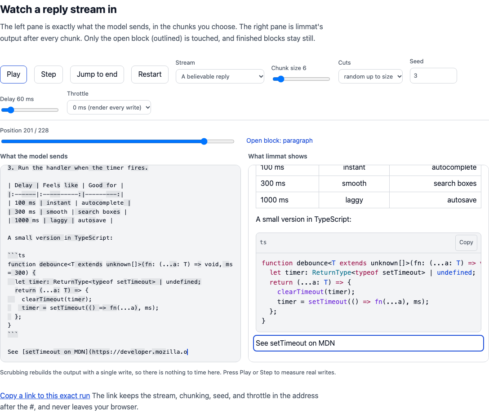

# limmat

[](https://github.com/DaanRosendal/limmat/actions/workflows/ci.yml)
[](https://www.npmjs.com/package/limmat)
[](docs/API.md)
[](LICENSE)

limmat renders streaming markdown into the DOM as it arrives. It is about 7 kB gzip, has no dependencies and no framework, and builds DOM nodes instead of HTML strings, so raw HTML in model output shows as text.

It is built for chat UIs where an LLM streams a reply in chunks of a few characters. Only the open block re-renders, and half-finished markdown never shows raw markers.

Status: 0.x, one maintainer. See [Stability](docs/API.md#stability) and [Project status](#project-status).

<p align="center">
  <a href="https://limmat.daanrosendal.com">
    <picture>
      <source media="(prefers-color-scheme: dark)" srcset="docs/demo-dark.png">
      
    </picture>
  </a>
</p>

**[Try the demo](https://limmat.daanrosendal.com)**: change the chunking, scrub through a stream, and throw hostile input at it. To run it yourself, clone the repo and use `npm run demo`.

```ts
import { createRenderer } from 'limmat';
import 'limmat/style.css'; // optional

const md = createRenderer(document.querySelector('#answer')!);
md.write('# Hello\n\nSome **streamed** text'); // call it for every chunk
md.end();
```

## Install

```sh
npm install limmat
```

No bundler? Copy `dist/limmat.min.js` (and optionally `dist/style.css`) into your project and import it as a module:

```html
<script type="module">
  import { createRenderer } from './limmat.min.js';
  const r = createRenderer(document.querySelector('#answer'));
  r.write('Hello **world**');
  r.end();
</script>
```

## Use

Use one renderer per message. `write` takes only the new text, and chunks can split anywhere, even inside a word or a marker. Rendering a finished string is the same three calls: `createRenderer(el)`, `write(text)`, `end()`.

Streaming a `fetch` response:

```ts
const res = await fetch('/api/chat', { method: 'POST', body });
const reader = res.body!.pipeThrough(new TextDecoderStream()).getReader();
const md = createRenderer(el);
for (let r = await reader.read(); !r.done; r = await reader.read()) md.write(r.value);
md.end();
```

With an LLM SDK, call `md.write(delta)` for each text delta and `md.end()` when the stream finishes.

With every option:

```ts
import { createRenderer } from 'limmat';
import { speedHighlight } from 'limmat/highlight';

const el = document.querySelector<HTMLElement>('#answer')!;
const knownPages = new Set(['/research/', '/about/']);
const md = createRenderer(el, {
  isInternalPath: (path) => knownPages.has(path),
  onLinkClick: (href, event) => {
    if (href.startsWith('/')) { history.pushState({}, '', href); return true; } // handled: limmat calls preventDefault
  },
  highlight: speedHighlight(),
  labels: { copy: 'Kopieren', copied: 'Kopiert' },
});
```

Options, methods, code highlighting, styling, and accessibility are in [docs/API.md](docs/API.md).

## Why limmat

- Only the open block re-renders, at most every 50 ms by default. A 100 KB reply in 5-character chunks with no pauses renders in about 10 ms in Chromium (about 130 ms with `throttleMs: 0`, which renders on every write).
- The DOM is built with `createElement` and text nodes. Links go through a protocol allow-list, and images are never loaded.
- Headings, emphasis, strikethrough, code with a language label and Copy button, nested and task lists, blockquotes, tables with alignment, links, autolinked URLs and emails, and hard breaks. Optional CSS, and an optional lazy code highlighter.

### Safety in short

- Raw HTML in the input is shown as text.
- Links need an allowed protocol (`https`, `http`, `mailto` by default). `javascript:`, `data:`, and `vbscript:` are refused even if you list them. External links get `rel="noopener noreferrer"`.
- Images are never created, so they cannot track or exfiltrate. The alt text is shown.
- Nesting and work are capped, so hostile input cannot overflow the stack or make parsing quadratic.
- limmat does not protect you from your own CSS or from what your callbacks do.

The full list is in [docs/SECURITY-MODEL.md](docs/SECURITY-MODEL.md).

## What is supported

Unsupported syntax renders as literal text, never as markup. Anything not listed here has not been audited. The table is generated from [docs/support.json](docs/support.json) and the CommonMark 0.31.2 results, and CI fails if it drifts, if a row cites a test that does not exist, or if a row says "supported" while most of its spec examples fail.

- **Supported**: works for the cases LLM chat produces, with tests.
- **Partial**: the common cases work, the notes say what does not.
- **Not yet**: not implemented, and a candidate for the roadmap.
- **Will not**: refused on purpose, usually for safety.
- **Spec examples**: CommonMark examples that pass, out of the examples in that section (including sections we do not aim for). The failures are listed by number in [test/fixtures/commonmark-known-failures.json](test/fixtures/commonmark-known-failures.json).

<!-- support:start (generated by scripts/gen-support.mjs from docs/support.json, do not edit) -->
| Feature | Status | Spec examples | Notes and proof |
|---|---|---|---|
| ATX headings (`# Title`) | Supported | 17/18 |  |
| Setext headings (`Title` over `---`) | Not yet | 12/27 | The underline renders as a rule (`---`) or as text (`===`). |
| Thematic breaks | Supported | 17/19 |  |
| Fenced code, backtick and tilde | Supported | 27/29 | Language label, Copy button, optional highlighting. Test: `tilde fences and fence lengths` in [conformance.test.ts](test/conformance.test.ts). |
| Indented code blocks | Not yet | 1/12 | Use fences. |
| Block quotes | Supported | 22/25 | Test: `lazy blockquote continuation only follows paragraph text` in [regress.test.ts](test/regress.test.ts). |
| Bullet and ordered lists, nested | Partial | 32/74 | Bullet, ordered, and nested lists work. Loose lists render tight, and many edge cases in the spec differ. Test: `list scanning` in [regress.test.ts](test/regress.test.ts). |
| Task lists (GFM) | Supported |  | Checkboxes are disabled and labelled. Test: `task lists` in [conformance.test.ts](test/conformance.test.ts). |
| Tables with alignment (GFM) | Supported |  | Keyboard-scrollable wrapper. Without a leading pipe, a header and delimiter row with different column counts is not a table. Test: `tables with alignment` in [conformance.test.ts](test/conformance.test.ts). |
| Emphasis and strong | Supported | 129/132 | `snake_case_words` stay text. |
| Strikethrough (GFM) | Supported |  | Needs two tildes on both sides. Test: `single tilde is literal` in [gaps.test.ts](test/gaps.test.ts). |
| Code spans | Supported | 20/22 |  |
| Inline links | Partial | 23/90 | Inline `[text](url)` works. Reference-style links, many title forms, and unsafe URLs render as text. These cause most of the misses. Test: `blocked links keep the label as text` in [xss.test.ts](test/xss.test.ts). |
| Reference links and definitions | Not yet | 5/27 | Render as text. Added if real LLM output needs them. |
| Autolinks: `<url>`, bare URLs, `www.`, emails (GFM) | Partial | 9/19 | Only allowed protocols become links, so spec examples with other schemes differ by design. Test: `urls only autolink at a word boundary` in [gaps.test.ts](test/gaps.test.ts). |
| Images | Will not | 1/22 | The alt text is shown and nothing is ever loaded, so images cannot track or exfiltrate. Test: `images become plain text` in [xss.test.ts](test/xss.test.ts). |
| Raw HTML and HTML blocks | Will not | 7/64 | Shown as text. Only `<br>` is understood. Test: `unsupported things degrade to text` in [conformance.test.ts](test/conformance.test.ts). |
| HTML entities (`&amp;`) | Not yet | 5/17 | Shown literally. |
| Backslash escapes | Partial | 9/13 |  |
| Hard and soft line breaks | Supported | 14/17 | Test: `single trailing space before newline` in [gaps.test.ts](test/gaps.test.ts). |
| Tabs for indentation | Not yet | 2/11 |  |
| Half-open constructs never show raw markers while streaming | Supported |  | Test: `open fence shows code immediately` in [half-open.test.ts](test/half-open.test.ts), `streaming never shows raw markers` in [behavior.spec.ts](browser/behavior.spec.ts). |
| Any chunking gives the same DOM as one write | Supported |  | Test: `two-part splits at every index` in [chunk-fuzz.test.ts](test/chunk-fuzz.test.ts). |
| Math (`$...$`, `$$...$$`) | Not yet |  | Planned as an opt-in option. Dollar signs render literally today. |
| Footnotes | Not yet |  | Render as text. Planned as an opt-in option. |
| Alerts and callouts (`> [!NOTE]`) | Not yet |  | Renders as a normal block quote. |
| Citation chips (`[1]`) and emoji codes | Not yet |  | Planned as opt-in options. Rendered literally today. |
<!-- support:end -->

Known issues, ideas, and decisions against, with reasons, are in [docs/ROADMAP.md](docs/ROADMAP.md).

## Compared with streaming-markdown

Checked against streaming-markdown 0.2.15 with its default renderer, in November 2026.

| | limmat | streaming-markdown |
|---|---|---|
| Size (gzip) | about 7 kB, including the Copy button | about 3.5 kB, parser and renderer only |
| Link and image URLs | allow-listed, images never load | not sanitized by the default renderer (`javascript:` and `//host` links pass, any image loads) |
| `snake_case_words` | stay text | become italic |
| `1)` lists, table alignment, `www.` links, bare emails | supported | not supported |
| Punctuation after a bare URL (`see https://a.com.`) | trimmed | kept in the link |
| `)` inside a URL | handled | ends the link |

## Why TypeScript, not Rust or WebAssembly

limmat's output is DOM nodes, and WebAssembly cannot touch the DOM, so a Rust parser would still hand every chunk's result back to JavaScript to build the elements. Size points the same way: the WebAssembly streaming renderers we measured in November 2026 were 29 to 105 kB gzip (md4w 28.7 kB, md4x 104.8 kB, flux-md about 104 kB of which the WebAssembly binary is 89 kB), against about 7 kB here. The work per chunk is small, since a 100 KB reply in 5-character chunks renders in about 10 ms in Chromium, so a faster parser would save little. This is a choice for a client-side chat widget. A Rust parser is a good fit on a server or for large documents.

## Tested

`npm run check` runs typecheck, lint, a style check, unit tests, a build, a package check, a support-table check, a size check, and the browser suite in Chromium, Firefox, and WebKit. That covers 54 XSS inputs run in real browsers, a malicious-input fuzz, a chunk-split fuzz (any chunking gives the same DOM as one write), half-open snapshots for every construct, 331 of 471 in-scope CommonMark examples, performance budgets, a memory test, and accessibility checks with axe. [test/README.md](test/README.md) says which suite guards what.

## Project status

limmat is a small project with one maintainer. Only the latest minor release is supported, and no release schedule is promised. Report bugs in [issues](https://github.com/DaanRosendal/limmat/issues) and security problems as described in [SECURITY.md](SECURITY.md). Contributions are welcome: start with [CONTRIBUTING.md](CONTRIBUTING.md) and the [roadmap](docs/ROADMAP.md).

Docs: [API](docs/API.md), [security model](docs/SECURITY-MODEL.md), [architecture](docs/ARCHITECTURE.md), [roadmap](docs/ROADMAP.md), [changelog](CHANGELOG.md).

## License

MIT, Copyright (c) 2026 Daan Rosendal. Named after the river through Zurich.
