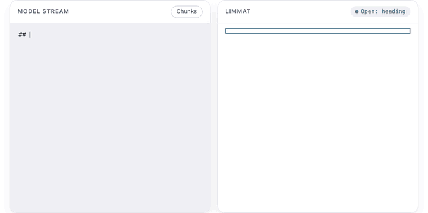

# limmat

Streaming markdown for LLM chat. Half-typed syntax like `[docs](https://example` or `# Titl` renders cleanly instead of showing raw text.

<p align="center">
  <a href="https://limmat.daanrosendal.com">
    <picture>
      <source media="(prefers-color-scheme: dark)" srcset="docs/demo-dark.gif">
      
    </picture>
  </a>
</p>

**[Try the demo](https://limmat.daanrosendal.com)**

- **No flicker.** Unfinished markdown shows as clean text until it is complete.
- **Predictable.** However the text is cut into chunks, the page ends up the same as rendering it all at once.
- **Safe.** It builds DOM nodes, never HTML strings, so hostile input shows up as plain text.
- **Any framework.** Give it any DOM element: React, Vue, Svelte, or plain JavaScript.
- **Small and fast.** 9 kB gzip, no dependencies. Only the open block re-renders: 100 KB takes about 10 ms in Chromium.

## Install

```sh
npm install limmat
```

```ts
import { createRenderer } from 'limmat';
import 'limmat/style.css'; // optional

const md = createRenderer(document.querySelector('#answer')!);
for await (const chunk of stream) md.write(chunk); // any source of text chunks
md.end();
```

Use one renderer per message: `write` takes only the new text. In a framework, give it an empty element and call `destroy()` when it unmounts. The options are `throttleMs`, `html`, `images`, `highlight`, `onLinkClick`, `isInternalPath`, `allowedProtocols`, `externalLinksNewTab`, `classPrefix`, and `labels`, each documented in the types.

For colored code, add the optional highlighter (it needs `@speed-highlight/core`, plus one of its theme stylesheets):

```ts
import { speedHighlight } from 'limmat/highlight';
createRenderer(el, { highlight: speedHighlight() });
```

## Browser support

| Chrome, Edge, and other Chromium browsers | Firefox | Safari (macOS and iOS) |
|:---:|:---:|:---:|
| ✅ | ✅ | ✅ |

Tested in Chromium, Firefox, and WebKit.

## Safety

Raw HTML shows as text, except attribute-free tags like `<kbd>` and `<sub>`, and collapsible `<details>`. Links must be http, https, mailto, or a site path you approve. Images load without a click, so a hostile reply can send data to its own server: pass `images: ['https://your-cdn.example']` or `images: false` to limit that. More in [SECURITY.md](SECURITY.md).

## What is supported

limmat follows the [CommonMark spec](https://spec.commonmark.org/0.31.2/) where it can. Anything it does not support falls back to plain text or a simpler element, never to raw HTML. The demo's "What's supported" tab shows how many CommonMark examples each feature passes.

<!-- support:start (generated by scripts/gen-support.mjs from docs/support.json, do not edit) -->
| Feature | Status | Note |
|---|---|---|
| Headings (`# Title`) | 🟢&nbsp;Supported |  |
| Horizontal rules (`---`) | 🟢&nbsp;Supported |  |
| Code blocks (fenced) | 🟢&nbsp;Supported | Language label, Copy button, optional highlighting. |
| Block quotes | 🟢&nbsp;Supported |  |
| Task lists | 🟢&nbsp;Supported | Checkboxes are read-only. |
| Tables | 🟢&nbsp;Supported |  |
| Bold and italic | 🟢&nbsp;Supported | `snake_case_words` stay text. |
| Strikethrough (`~~text~~`) | 🟢&nbsp;Supported | Needs two tildes. |
| Inline code | 🟢&nbsp;Supported |  |
| Collapsible sections (`<details>`) | 🟢&nbsp;Supported | Each tag alone on its line. |
| Line breaks | 🟢&nbsp;Supported |  |
| Half-typed markers hidden while streaming | 🟢&nbsp;Supported | One exception: the `<` of an email autolink. |
| Same output however the text is chunked | 🟢&nbsp;Supported |  |
| Lists | 🟡&nbsp;Partial | Nesting works. Loose lists render tight. |
| Links | 🟡&nbsp;Partial | `[text](url)` only. Titles and unsafe URLs show as text. |
| Autolinks (bare URLs, `www.`, emails) | 🟡&nbsp;Partial | Only http, https, and mailto. |
| Images | 🟡&nbsp;Partial | On by default and loaded without a click, so limit them with `images`. No titles. |
| Raw HTML | 🟡&nbsp;Partial | Shown as text, except a few tags like `<kbd>` and `<sub>`. |
| Backslash escapes | 🟡&nbsp;Partial | A few edge cases differ. |
| Underlined headings (`Title` over `---`) | ⚪&nbsp;Not&nbsp;yet | The underline shows as a rule or as text. |
| Indented code blocks | ⚪&nbsp;Not&nbsp;yet | Use fences. |
| Reference links (`[a][1]`) | ⚪&nbsp;Not&nbsp;yet | Shown as text. |
| HTML entities (`&amp;`) | ⚪&nbsp;Not&nbsp;yet | Shown literally. |
| Tab indentation | ⚪&nbsp;Not&nbsp;yet |  |
| Math (`$x$`) | ⚪&nbsp;Not&nbsp;yet | Will be an opt-in hook you supply. |
| Footnotes | ⚪&nbsp;Not&nbsp;yet | Shown as text. Will be opt-in. |
| Alerts (`> [!NOTE]`) | ⚪&nbsp;Not&nbsp;yet | Shown as a plain block quote. |
| Citations (`[1]`) and emoji codes | ⚪&nbsp;Not&nbsp;yet | Shown literally. Will be opt-in. |
<!-- support:end -->

Known limits:

- `throttleMs: 0` re-renders the open block on every write, so one very long paragraph gets slow. The default throttle (`throttleMs: 50`) prevents that.
- `[1]` shows as `1` until its closing bracket arrives, and the `<` of an `<email@example.com>` autolink shows until the `@` arrives.
- `#anchor` links and relative links without a leading slash show as plain text.

[AGENTS.md](AGENTS.md) for working on limmat, [SECURITY.md](SECURITY.md) to report a problem, and [CHANGELOG.md](CHANGELOG.md). Licensed under the [MIT License](LICENSE).
